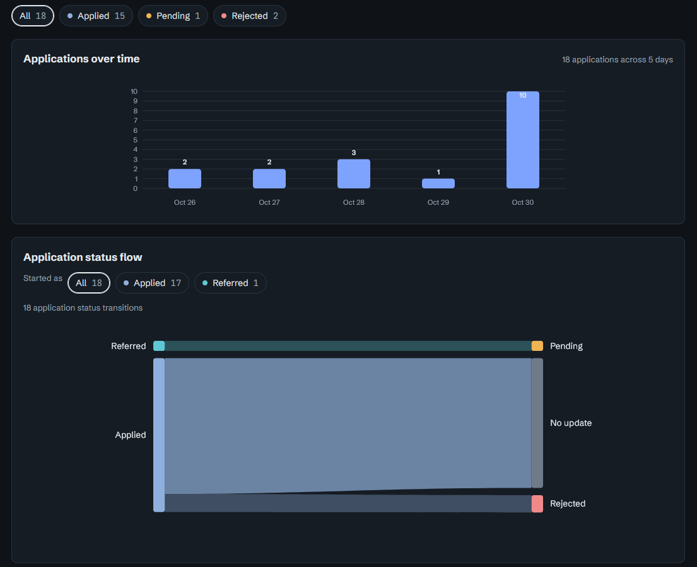
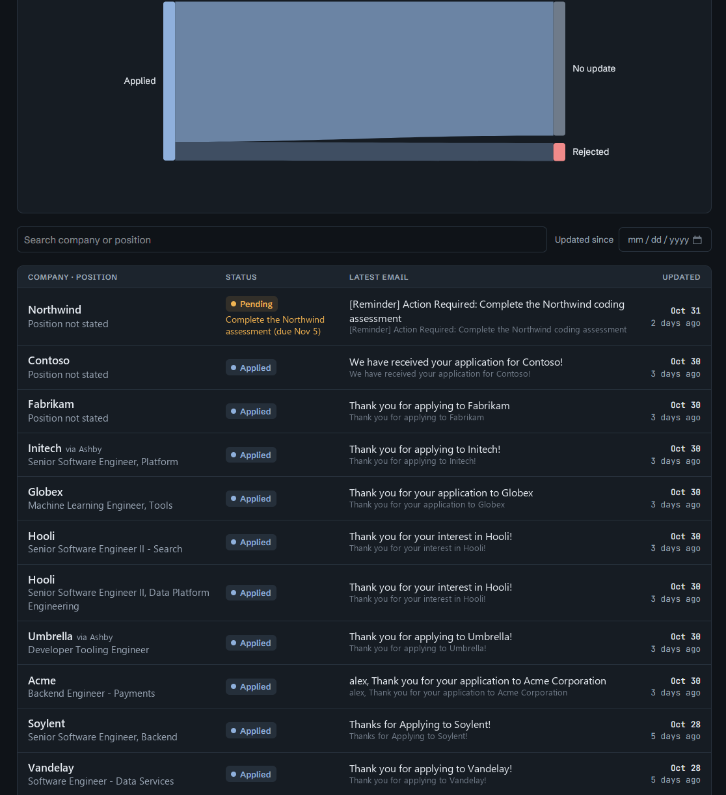

# Job application tracker - python scaper, classifier, visualizer

Two small Python programs (standard library only, Python 3.9+) and a web page.

| File | What it does |
| --- | --- |
| `gmail_scraper.py` | Downloads job-related mail from Gmail over IMAP (read-only) and writes `emails.json`. |
| `job_tracker.py` | Reads `emails.json` (or downloads and reads in one step), decides which messages are application notices, groups them into applications and prints a table, CSV or JSON. |
| `test_scraper.py` | 38 tests. The scraper is exercised against a fake IMAP server over real sockets, plus unit tests of its helpers. |
| `test_tracker.py` | 59 tests of the rules, grouping, output formats, validation and command line, using synthetic mail. |
| `fixtures/` | Real mail and hand labels used to check the rules (see "How far to trust it"). Contains personal data, so `.gitignore` excludes it; the fixture-based tests skip when it is absent. |
| the web page | Loads the JSON that `job_tracker.py` writes and shows it. It does not touch Gmail or call any AI. |

## Setup (once)

1. Turn on 2-Step Verification for the Google account, then create an app password at https://myaccount.google.com/apppasswords.
2. Put `gmail_scraper.py` and `job_tracker.py` in the same folder.

3. Copy `.env.example` to `.env` and put the app password in it. `.env` is gitignored.

The password is read from `GMAIL_APP_PASSWORD` in `.env` (next to `gmail_scraper.py`) or the environment (the environment wins; spaces are ignored), or asked for when the program starts. The program never writes it anywhere.

## Use

```
# see what would be downloaded, without saving anything
python gmail_scraper.py --user you@gmail.com --since 2026-10-20 --dry-run

# download, classify and write the file the web page loads
python job_tracker.py imap --user you@gmail.com --since 2026-10-20 --format json --out applications.json

# or keep the raw mail too, so you can re-run the rules without downloading again
python job_tracker.py imap --user you@gmail.com --since 2026-10-20 --save-emails emails.json --format json --out applications.json
python job_tracker.py scan emails.json --format table
```

`--since` is the configurable date (UTC day, inclusive). `--before` is an optional end date (exclusive). Add `--all` to `imap` or the scraper to download every message in the window instead of only keyword matches, which is the fallback if the keyword filter misses mail.

Then open the page and load `applications.json`.



The flow diagram starts each application at the status of its first email (Applied or Referred) and ends it at its current status. Use "Started as" to show only applications that began as a referral or as an application.



Each row is one application: its status (with the task waiting on you, if any), the latest email and when it arrived. Company names, roles and email subjects in these screenshots are made up.

## Statuses

Referred, applied, pending (something is waiting on you; the item is shown), interviewing, offer, accepted, rejected, withdrawn, unknown. Unknown means the latest email mentions the application but says nothing about its status; in the flow diagram it is labelled "Other" on the left (where applications start) and "Unknown" on the right (where they stand now), for example Other → Applied when a security-code email came before the confirmation. Referred and applied are both initial application states; an application's status is the status of its most recent notice. Rules are in `PATTERNS` at the top of `job_tracker.py`.

## How far to trust it

Rules were checked against hand-labelled real mail. The honest numbers:

| Set | First run, rules not yet adjusted to it | After fixing the rules it exposed |
| --- | --- | --- |
| Mail since 2026-10-20 (46 messages, 18 applications) | the rules were written against this set | 18 / 18 applications |
| Hold-out 1: older mail (20 notices, 15 applications) | 10 / 20 notices, 2 / 15 applications | 15 / 15 |
| Hold-out 2: older mail (21 notices, 19 applications) | 17 / 21 notices, 7 / 19 applications | 19 / 19 |

An application counts as right only when company, position, status and date are all right. The "after" column is not a prediction: each hold-out stopped being a hold-out when it was used to fix the rules. No untouched set is left, so accuracy on your next batch of mail is unknown, and the first-run numbers above are the better guide. Expect mistakes in company names, missing positions and unusual wording, and use the page's status control to correct a status.

Not checked at all: `accepted` and `withdrawn` (no real examples in the mailbox), and the scraper against real Gmail (it was tested against a fake IMAP server). Run `--dry-run` first.

Check the rules yourself any time:

```
python job_tracker.py validate fixtures/emails_since_2026-10-20.json fixtures/expected_since_2026-10-20.json
python job_tracker.py validate fixtures/emails_holdout_before_2026-10-20.json fixtures/expected_holdout_before_2026-10-20.json
python job_tracker.py validate fixtures/emails_holdout2_before_2026-10-20.json fixtures/expected_holdout2_before_2026-10-20.json
python test_scraper.py
python test_tracker.py
```

## Keeping personal data out of git

`.gitignore` excludes downloaded mail (`emails*.json`), tracker output (`applications*.json`, `*.csv`), `fixtures/`, credentials and caches. The source files still contain the Gmail address as an example (README, `job-tracker.html`, `test_scraper.py`); replace it with a placeholder before publishing.
